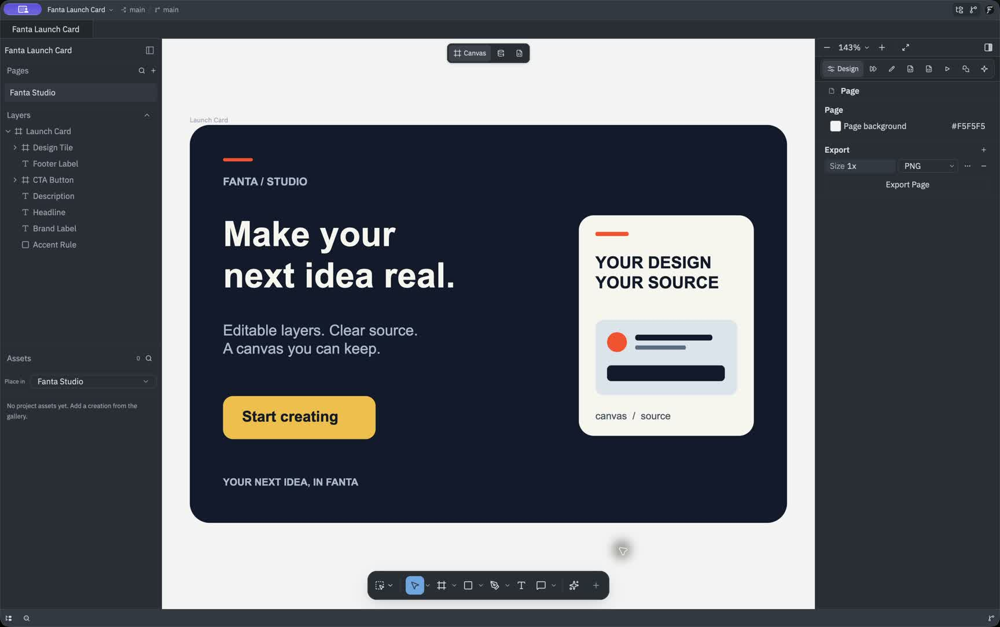
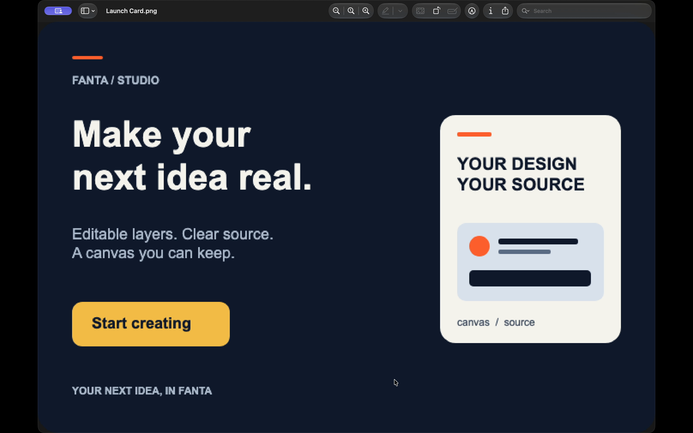
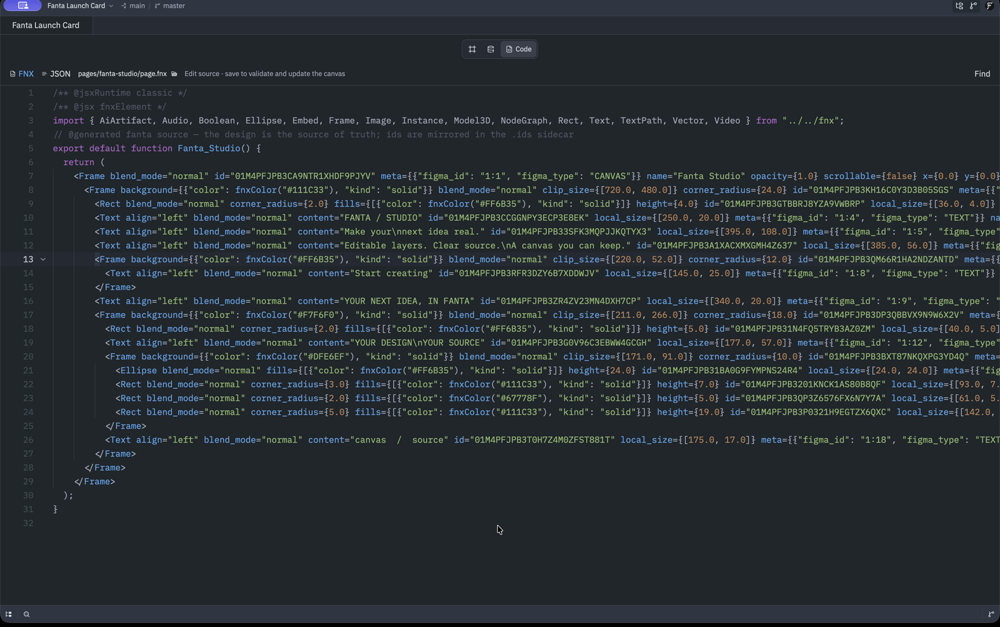

# Fanta

**Your design is source.** Fanta is a native macOS design editor. Import a
`.fig`, create a design, or open a Fanta project folder. Canvas changes save as
readable FNX alongside the project's assets, so you can inspect changes with
Git and edit the same design through the Code workspace or an agent.

The **Fanta 1.0.0 Public Alpha** distribution targets Apple Silicon Macs.
The final Build45 package is Developer ID signed, Apple-notarized and stapled;
bounded quarantined installation, save/reopen and same-build replacement passed.
Three captioned workflows and a launch overview have been reviewed on the same
signed build. The **Public Alpha is available**. Use the download page for the
verified installer, checksum, tested requirements and current limitations.

[Download and installation](https://www.fantaisa.net/download) ·
[Three demos and the ten-minute exercise](docs/alpha/DEMO_GUIDE.md) ·
[Capability guide](docs/fanta/capabilities.md) ·
[Connect an agent](docs/fanta/agent-quickstart.md) ·
[Fanta Community on Discord](https://discord.gg/qrFtymBYxk)

## Install

Once the [download page](https://www.fantaisa.net/download) reports public
availability, use its installer link, open `Fanta-aarch64.dmg` and drag **Fanta**
into **Applications**. Check the published SHA-256 checksum before installation.
The accepted Build45 package has passed Developer ID signature, Apple
notarization, stapling and Gatekeeper checks. Do not remove quarantine attributes
or disable Gatekeeper to install it.

Apple Silicon is the first release target. The download page lists the macOS
versions actually tested for the published package. A compiler deployment target
does not establish support for an older macOS version. Automatic updates are
disabled in this alpha; use the [manual replacement steps](docs/alpha/PUBLIC_ALPHA.md#manual-updates).

The [current installation guide](docs/alpha/PUBLIC_ALPHA.md) covers verification,
requirements, limitations and troubleshooting. Earlier alpha reports retain their
original dates and build identities.

## Start with one small design

1. Unzip the owned [Fanta Launch Card sample](docs/samples/Fanta-launch-card-sample.zip)
   into a folder you own. Open its native project or import the included original
   [`.fig`](docs/samples/Fanta-Launch-Card.fig). Keep the original file: edits save
   into a separate Fanta project folder.
2. Change one layer on the canvas. Use Undo and Redo to inspect the result.
3. Open **Code** to see the corresponding FNX. The Code workspace edits supported
   FNX and JSON in saved projects. Save a valid draft to update the canvas.
4. Use **Review Changes** to inspect the Git diff, then save, close and reopen the
   project. Keep its manifest, source, identity sidecars and assets together.
5. Export a selection as PNG and open the resulting image.

[Follow the ten-minute exercise](docs/alpha/DEMO_GUIDE.md#the-ten-minute-exercise).
The reviewed recordings show the real native canvas and editable Code workspace
on the accepted signed Build45 app. Captions identify later checks and reopened
views. [Their provenance](docs/screenshots/README.md) keeps the earlier internal
QA screenshots separate. [Watch the launch overview and three workflows](docs/alpha/DEMO_GUIDE.md).

[](https://www.fantaisa.net/#demo-native)

The actual exported PNG opens outside Fanta after the saved project check.



The same project's FNX in the native Code workspace, with the saved text change
visible. FNX and supported JSON are edited in Fanta; Dev mode's **Saved Code**
is a separate read-only view.

[](https://www.fantaisa.net/#demo-source)

[Native Undo/Redo GIF](docs/screenshots/public-alpha-20261012/design-in-fanta.gif) ·
[Code-to-canvas GIF](docs/screenshots/public-alpha-20261012/your-design-is-source.gif) ·
[Agent result GIF](docs/screenshots/public-alpha-20261012/agent-edits-your-design.gif)

## Connect an agent

The [agent recording](docs/alpha/DEMO_GUIDE.md#an-agent-edits-your-design) shows
an external Opus 5.5 agent changing one CTA through Fanta MCP, followed by native
result inspection, saved FNX and Undo/Redo.

Open the intended project in Fanta and choose **Connect Codex or Claude Code**.
Use the copied project-scoped instructions: they identify the running executable
and its user-data directory. Keep that Fanta instance open, restart your agent,
check its MCP connection and call `get_editor_state` before editing.

The local bridge exposes the focused design, project source inspection and
validation, bounded design operations, screenshots and comments. It runs over a
local Unix socket. External file edits enter through the project's reconciliation
path. Built-in agent tools and hosted media generation have separate configuration
and billing requirements. See the [agent quickstart](docs/fanta/agent-quickstart.md)
for exact tool names and a bounded first task.

## Build from source

```sh
cargo run -p fanta
```

The executable is named `fanta`.

- `cargo build -p fanta` builds the app.
- `./script/clippy -p <crate>` runs the repository's lints for a crate; without
  `-p` it lints the whole workspace in release mode.
- `./script/bundle-mac` builds a local bundle and emits matching crash symbols.
  A local bundle does not establish acceptance of the public installer.
- `./script/smoke-mcp <fanta-binary> <project-dir>` exercises the local agent
  bridge against a running application.

The design engine lives in `crates/fanta-*`. Reusable GPUI and Fanta UI packages
come from [fanta-ui](https://github.com/squidred-dev/fanta-ui). `Cargo.lock` records
its dependency revisions.

## Limitations and feedback

This is an alpha. The [current capability guide](docs/fanta/capabilities.md)
distinguishes implemented behavior from build-specific native checks. In
particular, not every imported Figma feature has identical rendering, saving
multiple source buffers is sequential, and concurrent external writes can
require conflict resolution. Start with a copy of a small project.

Report reproducible bugs through the support links on the download page. Include
the app version, macOS version, steps and expected versus observed behavior.
Join [Fanta Community](https://discord.gg/qrFtymBYxk) for installation help,
workflow questions and project showcases.
Logs live in `~/Library/Logs/Fanta/`; remove secrets and private project content
before attaching them. Send private account or billing reports to
[support@fantaisa.net](mailto:support@fantaisa.net).

## License

GPL-3.0-or-later. See `NOTICE.md` and `LICENSE-GPL`.
The editor and vendored engine source are in this repository. The GPUI fork and
reusable components are published from [fanta-ui](https://github.com/squidred-dev/fanta-ui).
