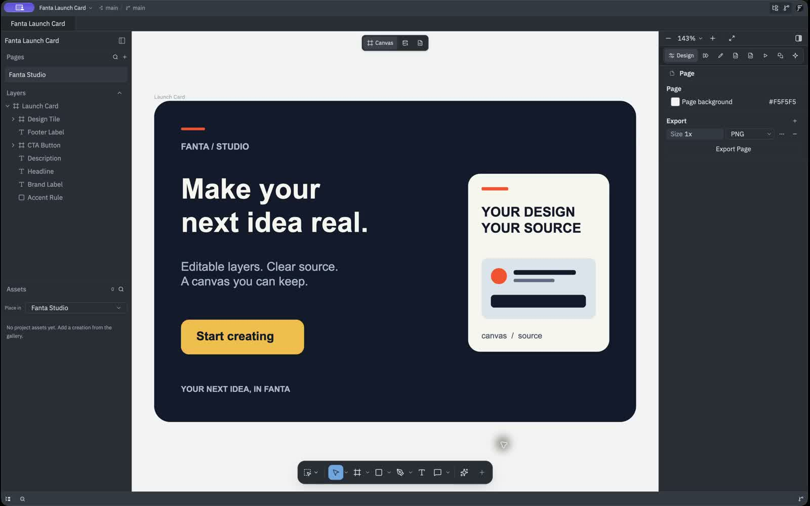
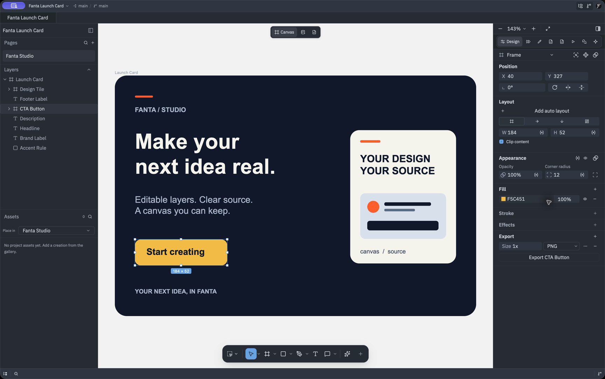
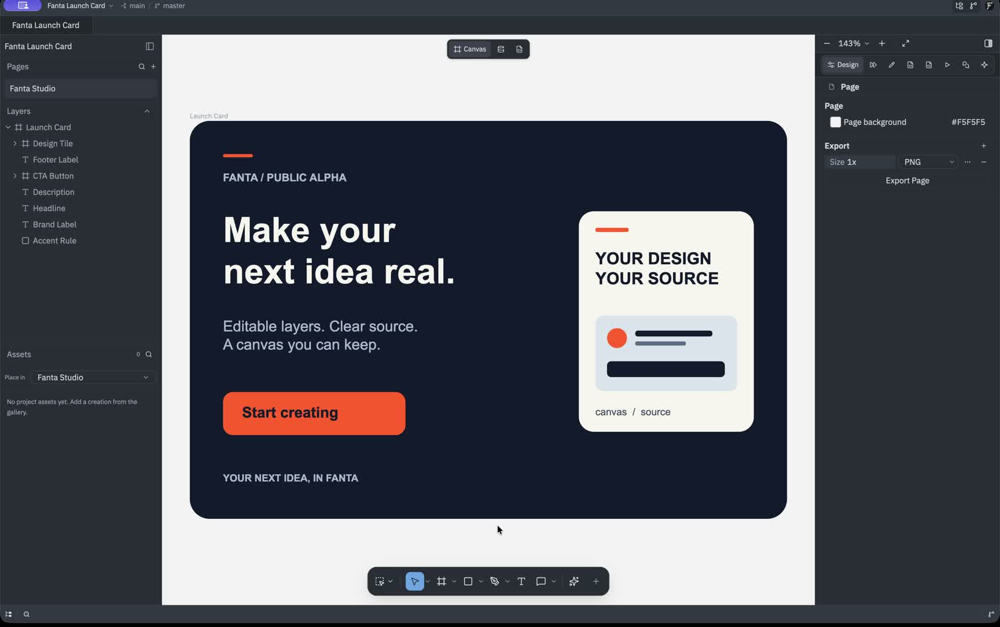
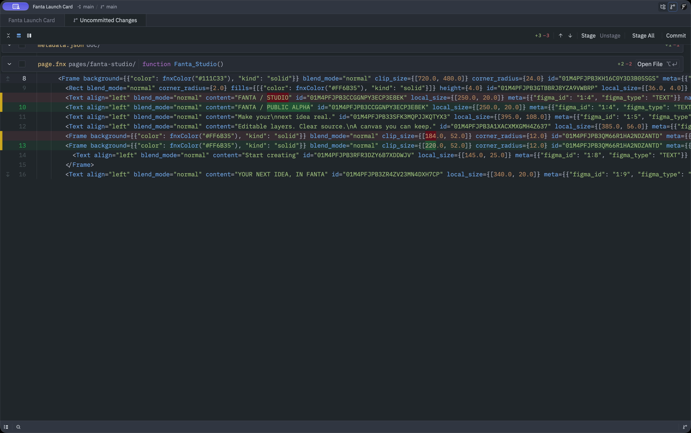
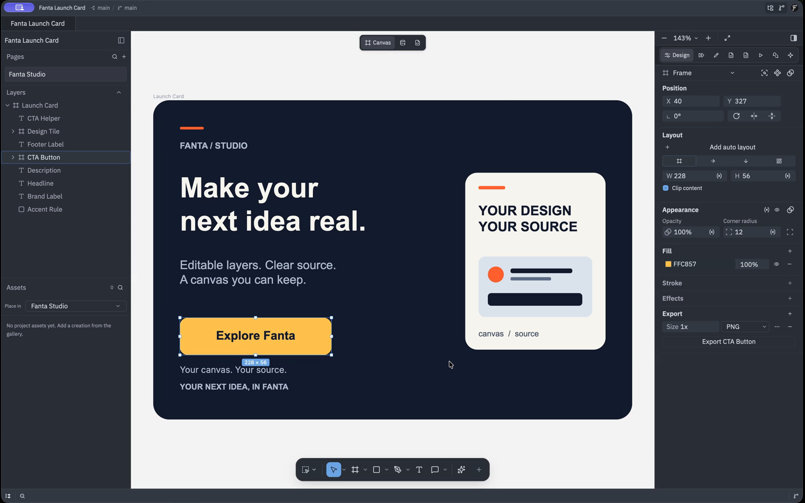
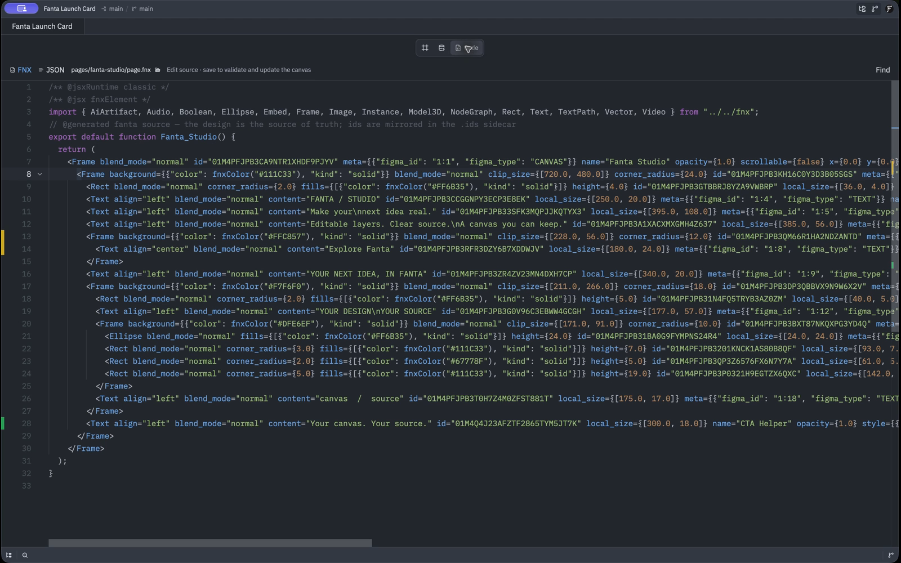

# Fanta demos and the ten-minute exercise

Updated **12 October 2026**. The reviewed launch overview and three workflows use
the accepted signed Build45 Public Alpha app. The original long recordings and
editable cuts are retained privately for the creator. These silent exports use
captions, including labels for later checkpoints and reopened views.

[Watch the reviewed demos](https://www.fantaisa.net/#demo) when the prepared
website is published. Public app availability remains on hold pending website
review and publication checks; the [download page](https://www.fantaisa.net/download)
reports current availability.

| Demo | Result to watch for |
| --- | --- |
| Design in Fanta | Native imported layers change, Undo restores an edit, saved content reopens, and an exported PNG opens |
| Your design is source | A canvas edit produces an FNX/Git change, then a valid Code edit updates the canvas |
| An agent edits your design | External Opus 5.5 makes one bounded CTA edit through Fanta MCP, followed by inspected source and Undo/Redo |

## Design in Fanta

Edit layers imported from the owned original `.fig`, inspect Undo/Redo, then
check the reopened saved project and its actual PNG. The final PNG view is a
later verification of that export, identified by captions.

[Watch the short silent Undo/Redo GIF](../screenshots/public-alpha-20261012/design-in-fanta.gif).

## Your design is source

Inspect FNX in Code, save a valid edit and see the canvas update. The final
Git checkpoint shows the saved project's actual diff; captions identify this
later checkpoint.

[Watch the short silent Code-to-canvas GIF](../screenshots/public-alpha-20261012/your-design-is-source.gif).

## An agent edits your design

An external **Opus 5.5** agent edits one CTA through Fanta MCP. The footage shows
the native result, its properties, saved source and Undo/Redo. The request ran
through the external client; the app footage shows the actual result and its
inspection. Captions identify the later reopened source view after the documented
[Code refresh warning](PUBLIC_ALPHA.md#current-limitations).

[Watch the short silent agent-result GIF](../screenshots/public-alpha-20261012/agent-edits-your-design.gif).

## The ten-minute exercise

Unzip the owned [Fanta Launch Card sample](../samples/Fanta-launch-card-sample.zip)
into a folder you own. Open its native project or import the included original
[Fanta Launch Card `.fig`](../samples/Fanta-Launch-Card.fig). The card uses native
text and shapes without third-party artwork. Keep a fresh copy for resets.

| Time | Action | Observable result |
| --- | --- | --- |
| 0–2 min | Open the unzipped native project, or import its original `.fig` and save into a new folder | The canvas and layer list show the same card |
| 2–4 min | Select one shape and change its fill or position. Use Undo, then Redo | The layer returns to its before and after states |
| 4–6 min | Save and open Code. Locate the selected layer's FNX and inspect Review Changes | The source and Git diff reflect the edit |
| 6–8 min | In Code, change a text layer's existing `content` literal and save valid source | The canvas shows your new text |
| 8–10 min | Save, close and reopen the project, then export a selected frame as PNG | The change survives reopening and the PNG opens outside Fanta |

Use a literal already present in your file, preserve node IDs and avoid changing
manifest or identity sidecars. An invalid source draft retains the last valid
canvas and reports an error. Resolve or discard the draft before visual edits.

## Agent extension

Follow the [agent quickstart](../fanta/agent-quickstart.md) and verify the correct
open project before asking for one change:

> On the open sample, change only the existing button label to “Explore Fanta”.
> Keep its geometry, styles, IDs and all other layers unchanged. Inspect the
> result and stop. Do not generate media or call paid services.

Check the changed layer and its FNX, then use Undo and Redo. The first exercise
does not require a paid generation job.

## Visual asset placement

The [asset inventory](../screenshots/README.md) identifies the reviewed current
recordings and keeps historical QA captures separate. Videos on the prepared
website are silent with captions and load on demand. The earlier internal QA
[canvas](../screenshots/build45-canvas.png), [Code](../screenshots/build45-source.png)
and [Git](../screenshots/build45-diff.png) images retain their original identities.
