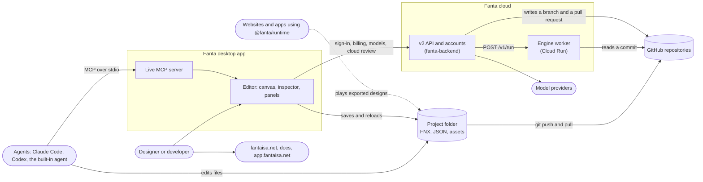
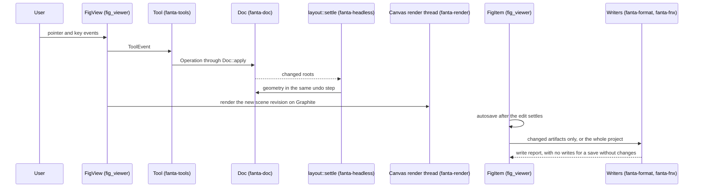
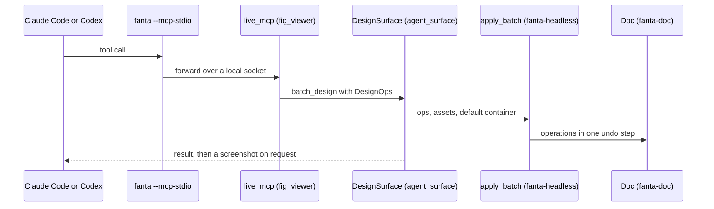
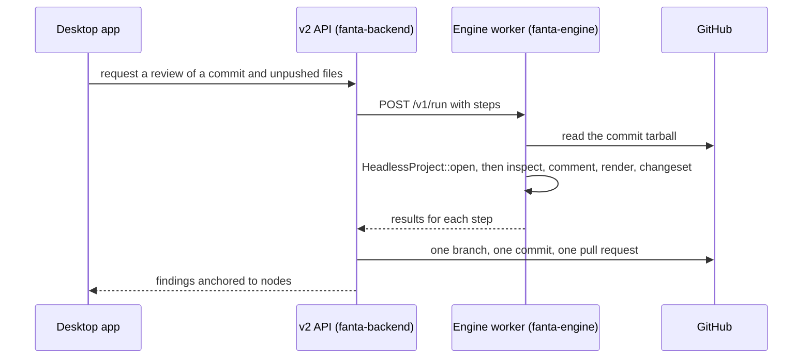

# Fanta architecture

How Fanta is built, from the systems around it down to the crates, and the
rules that keep it that way. Each part has an owner:

| Part | What it is | How it stays true |
| --- | --- | --- |
| This guide | The big picture, drawn and written by hand | Updated in the pull request that changes what it describes |
| [Crate map](crate-map.md) | Every Fanta crate, its layer and its dependencies | Generated by `script/architecture map`; CI fails when stale |
| [`layers.toml`](layers.toml) | Which layer may depend on which | Enforced by `script/architecture check` in CI |
| [Decisions](../decisions/README.md) | Why it is built this way | One record per decision; the index is generated |
| [Specs](../../specs/README.md) | What is being built next | One folder per change; the index is generated |

## The system



A design is a folder of readable source ([0004](../decisions/0004-store-designs-as-project-folders-of-fnx-source.md)),
and those files are the truth ([0009](../decisions/0009-make-project-files-authoritative.md)).
People edit on the canvas, agents edit through the live MCP server or the
files ([0007](../decisions/0007-give-agents-a-live-design-seam-and-mcp-server.md)),
and Git carries every change. The cloud reads the same files from GitHub and
runs the same engine ([0021](../decisions/0021-run-cloud-work-in-a-stateless-engine-worker.md)).

## Repositories and deployables

As of 2026-10-27. [ADR 0025](../decisions/0025-organize-the-repositories-under-one-github-organization.md)
proposes moving all of them into the `fantaisa-ai` organization, and
[ADR 0024](../decisions/0024-move-the-engine-into-its-own-repository.md)
proposes giving the engine its own repository.

| Deployable | Repository | Built with | Runs on |
| --- | --- | --- | --- |
| Desktop app | `jeanc18rlos/fanta-edit` (this one) | Rust, GPUI, Skia Graphite on Metal | macOS; Windows and Linux in progress ([0019](../decisions/0019-build-and-release-for-windows-and-linux.md)) |
| Engine crates | this repository, `crates/fanta-*` | Rust, Skia | Everywhere the app, the worker or the runtime runs |
| Engine worker | this repository, `crates/fanta-engine` | Rust | Google Cloud Run, Linux |
| GPUI and shared UI | `squidred-dev/fanta-ui` | Rust, published as `fanta-gpui-*` 0.5.0 and pinned by git revision ([0011](../decisions/0011-consume-gpui-and-shared-ui-from-fanta-ui.md)) | Inside the app |
| Runtime and SDK packages | `jeanc18rlos/Fanta-JS` | TypeScript and WebAssembly, built from a pinned fanta-edit commit ([0018](../decisions/0018-build-the-portable-runtime-here-and-package-it-in-fanta-js.md)) | npm: browsers and Node |
| v2 API, accounts, billing, cloud jobs | `jeanc18rlos/fanta-backend` (private) | Next.js and TypeScript | Vercel, with Cloud Run for the worker |
| Dashboard | `jeanc18rlos/fanta-dashboard` (private, package `fanta-app`) | Next.js | app.fantaisa.net |
| Landing and download page | `jeanc18rlos/fantaisa-landing` (private) | Next.js | fantaisa.net |
| Docs | `jeanc18rlos/fanta-docs` | Next.js and Fumadocs | docs.fantaisa.net |
| Admin | `jeanc18rlos/fanta-admin` (private) | Next.js | Internal |

## Inside the engine and the editor

The [crate map](crate-map.md) draws every Fanta crate and its dependencies.
In short, from the inside out:

- **Model** (`fanta-doc`): the document. Every change is an `Operation`
  applied through `Doc::apply`, which records undo history.
- **Design-op vocabulary** (`fanta-design-ops`): the typed ops and queries
  agents and the cloud send.
- **Interaction** (`fanta-canvas`, `fanta-tools`): viewport math, hit
  testing, snapping and tool state machines. Pure logic.
- **Source and import** (`fanta-fnx`, `fanta-format`, `fanta-bundle`,
  `fanta-fig-interop`): the FNX language, the project folder format, the
  parser-free runtime bundles and `.fig` import.
- **Rendering** (`fanta-text`, `fanta-render`): text layout and the renderer
  on Skia.
- **Playback** (`fanta-present`): prototypes and motion over an immutable
  document.
- **Application** (`fanta-headless`, `fanta-api`): open, edit, settle,
  render and save a project without the app, and the programmatic design API.
- **Engine hosts** (`fanta-engine`, `fanta-runtime`, `fanta-site`): the cloud
  worker, the portable player and the website exporter.
- **Desktop editor** (`fig_viewer`, `design_surface`, `fanta_ui`,
  `fanta_languages`): the GPUI host.
- **App** (`fanta`): the binary that wires the editor into the shell.
- **Inherited shell**: every other crate, inherited from Zed
  ([0002](../decisions/0002-build-fanta-on-a-fork-of-zed.md)); the crate map
  counts them.

Three rules carry most of the weight ([0023](../decisions/0023-enforce-layered-crate-boundaries.md)):
the engine never depends on the editor, the shell or `fanta-ui`; the model,
vocabulary, interaction, and source and import layers never reach Skia
([0003](../decisions/0003-keep-skia-out-of-the-document-model.md)); and the
shell reaches the canvas only through `design_surface`.

### Ports and adapters

| Role | Where |
| --- | --- |
| Domain | `fanta-doc`: `Doc`, `Scene`, `Operation`, history |
| Driving ports, which hosts call | `HeadlessProject` (`fanta-headless`), `DesignSession` (`fanta-api`), the `DesignOp` vocabulary, `DesignSurface` |
| Driven ports, which the engine calls | `AssetResolver` and `DecodeListener` (images for the renderer), `ImageStore`, `ImageFetcher` (template data), `FormatHandler` (file formats), `LayoutTree` |
| Driven adapters | Skia (`fanta-render`, `fanta-text`), files (`fanta-fnx`, `fanta-format`), `.fig` (`fanta-fig-interop`) |
| Driving adapters | `fig_viewer` (desktop), `fanta-engine` (HTTP worker), `fanta-runtime` (WebAssembly and C bridge), `fanta-site` (command line) |

## How changes flow

### A canvas edit



### An edit from outside

An agent rewrites a `.fnx` file, or Git switches branches. The worktree
reports the changed paths, `FigItem` waits out a 300 ms burst, reads the
files, and either replaces a clean document or merges into one with unsaved
edits through `fanta_format::merge_docs`. Only conflicting values ask the user.

### A live agent edit



The built-in agent takes the same path from its tools in
`crates/agent/src/tools/design_*_tool.rs`, resolving `DesignSurface` from a
GPUI global. The edit reaches the files through the canvas's normal save.

### A cloud review



The worker is stateless and never writes to GitHub. The contract is frozen in
[cloud-engine-contracts.md](../cloud-engine-contracts.md).

### Designs outside the app

`fanta-site` exports a static, read-only website from a project. The
`fanta-runtime-wasm` binary, built by Fanta-JS, plays designs in browsers and
Node with the same engine; a parity fixture keeps native and WebAssembly
results identical.

## Invariants

- Files are authoritative; the document is a cache, and a save without
  changes writes nothing ([0009](../decisions/0009-make-project-files-authoritative.md)).
- Persisted ids use the bare serde form; tools, logs and file names use the
  prefixed form ([0014](../decisions/0014-persist-ids-in-serde-form.md)).
- The editor and the cloud share one implementation of open, settle, render
  and save ([0020](../decisions/0020-share-one-headless-engine-between-the-editor-and-the-cloud.md)).
- Contracts change in pairs: the cloud contract with the backend, design ops
  with the five places that describe them to agents
  ([`design_surface/AGENTS.md`](../../crates/design_surface/AGENTS.md)).
- Releases are verified by named stages and required regressions, and signed
  only in CI ([0013](../decisions/0013-gate-releases-on-named-verification-suites.md),
  [0012](../decisions/0012-distribute-a-notarized-dmg-with-web-billing.md)).

## Where the code and the architecture disagree

Known debt, measured on 2026-10-27. Fix it when a change passes through; each
fix cites [ADR 0023](../decisions/0023-enforce-layered-crate-boundaries.md).

- `fig_viewer` is 172,297 lines in 83 files, about 92,900 of them tests;
  `view.rs` has 23,910 and `document.rs` 12,081. The document lifecycle
  (watching, reconciliation, merge, autosave) lives in this GPUI crate.
- The save path exists twice. `fanta_headless::save::save_project` makes the
  writer calls for the engine, while `fig_viewer`'s `document.rs` calls the
  `fanta-format` writers itself. One implementation should own it.
- About 16,000 lines of `fig_viewer` use no GPUI and belong in the engine:
  `layer_context_ops`, `measurements`, `export`, `instance_text`,
  `annotations`, `motion_edit`, `motion_stage`, `motion_video`, `clipboard`,
  `component_actions`, `prototype_player` and `draw_wand`.
- `fanta-present` depends on `fanta-render`, which ties playback to one
  renderer, and `fanta-text` mixes the rich-text model with Skia layout.
- Engine licence fields disagree: most crates inherit the workspace's
  `GPL-3.0`, while `fanta-design-ops`, `fanta-headless` and `fanta-api` say
  `GPL-3.0-or-later` ([0026](../decisions/0026-choose-the-engine-and-sdk-licence.md)).
- The engine can only be reached through this repository
  ([0024](../decisions/0024-move-the-engine-into-its-own-repository.md)).

## Regenerating and checking

```bash
script/architecture verify
```

```bash
script/architecture map
```

```bash
script/architecture index
```

`verify` is what CI runs. `map` and `index` rewrite the generated files after
you change `layers.toml`, a crate's dependencies or a record.
