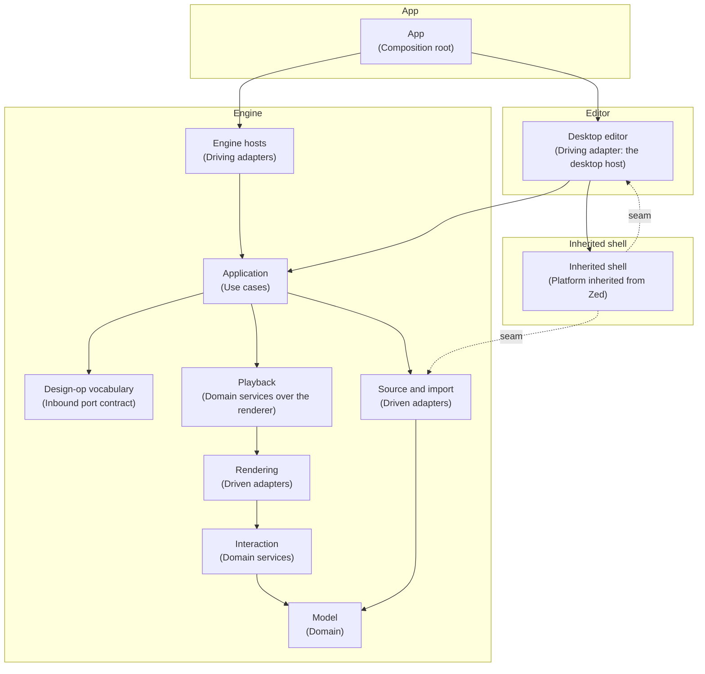
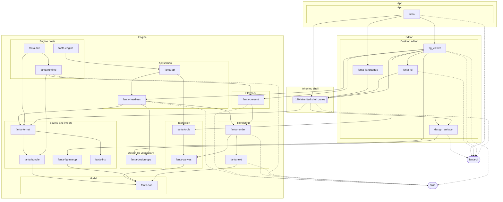

# Crate map

Generated by `script/architecture map` from [`layers.toml`](layers.toml). Do not edit by hand.
The [architecture guide](README.md) explains the layers and the rules.

## Layers

An arrow means "may use". Use is transitive: a layer may also use what its
targets may use. `script/architecture check` fails on any other dependency
unless a seam below allows it.

| Layer | Group | Role | Crates | What it holds |
| --- | --- | --- | --- | --- |
| Model | Engine | Domain | `fanta-doc` | The design document: scene graph, operations and undo, components, variables, layout, motion and prototype data. |
| Design-op vocabulary | Engine | Inbound port contract | `fanta-design-ops` | The ops, queries and comment drafts that agents and the cloud send, shared by the editor and the headless engine. |
| Interaction | Engine | Domain services | `fanta-canvas`, `fanta-tools` | Pure logic over the model: viewport math, hit testing, snapping and tool state machines. |
| Source and import | Engine | Driven adapters | `fanta-bundle`, `fanta-fig-interop`, `fanta-fnx`, `fanta-format` | The FNX source codec, the project directory format, runtime bundles and .fig import. |
| Rendering | Engine | Driven adapters | `fanta-render`, `fanta-text` | Text layout and the renderer, both on Skia. |
| Playback | Engine | Domain services over the renderer | `fanta-present` | Prototype and motion playback over an immutable document. |
| Application | Engine | Use cases | `fanta-api`, `fanta-headless` | Open, edit, settle, render and save a project without the app, and the programmatic design API over it. |
| Engine hosts | Engine | Driving adapters | `fanta-engine`, `fanta-runtime`, `fanta-site` | Deliverables built on the engine without the editor: the cloud worker, the portable runtime and the website exporter. |
| Desktop editor | Editor | Driving adapter: the desktop host | `design_surface`, `fanta_languages`, `fanta_ui`, `fig_viewer` | The GPUI canvas, inspector, panels, live MCP server and the DesignSurface seam. |
| App | App | Composition root | `fanta` | The `fanta` binary. |
| Inherited shell | Inherited shell | Platform inherited from Zed | 129 crates | Every workspace crate that no other layer lists. |

## Crates

Solid arrows are normal and build dependencies, reduced: an arrow is left
out when a longer path already connects the two crates. Dotted arrows lead
to external package families. The table lists every direct dependency.

| Crate | Layer | Description | Depends on | Used by |
| --- | --- | --- | --- | --- |
| [`fanta-doc`](../../crates/fanta-doc) | Model | Polymorphic scene graph, CanvasNode enum, undo/redo, selection. Renderer-agnostic. | — | `fanta-api`, `fanta-bundle`, `fanta-canvas`, `fanta-engine`, `fanta-fig-interop`, `fanta-format`, `fanta-headless`, `fanta-present`, `fanta-render`, `fanta-runtime`, `fanta-site`, `fanta-text`, `fanta-tools`, `fig_viewer` |
| [`fanta-design-ops`](../../crates/fanta-design-ops) | Design-op vocabulary | The design ops, queries and comment drafts agents edit Fanta designs with, shared by the editor and the headless engine. | — | `design_surface`, `fanta-api`, `fanta-engine`, `fanta-headless` |
| [`fanta-canvas`](../../crates/fanta-canvas) | Interaction | Viewport (pan/zoom), hit testing, snapping, alignment, distribution. | `fanta-doc` | `fanta-api`, `fanta-headless`, `fanta-present`, `fanta-render`, `fanta-tools`, `fig_viewer` |
| [`fanta-tools`](../../crates/fanta-tools) | Interaction | Tool state machines — select, marquee, pen, rect, ellipse, line, text, hand. | `fanta-canvas`, `fanta-doc` | `fanta-api`, `fig_viewer` |
| [`fanta-bundle`](../../crates/fanta-bundle) | Source and import | Runtime bundles: the parser-free program format fanta-runtime loads, written by fanta-compile and fanta-site. | `fanta-doc` | `fanta-format`, `fanta-runtime` |
| [`fanta-fig-interop`](../../crates/fanta-fig-interop) | Source and import | .fig (Figma) import: Kiwi binary codec, .fig container framing, and node mapping into fanta-doc. | `fanta-doc` | `fig_viewer` |
| [`fanta-fnx`](../../crates/fanta-fnx) | Source and import | The .fnx design-as-source language: lossless React/JSX-style text <-> the doc's per-node JSON projection, with an id sidecar. | — | `fanta-format`, `fig_viewer` |
| [`fanta-format`](../../crates/fanta-format) | Source and import | .fant zip container (JSON doc + content-addressed assets), git-native .fnx project tree, schema migrations. | `fanta-bundle`, `fanta-doc`, `fanta-fnx` | `fanta-api`, `fanta-headless`, `fanta-site`, `fig_viewer`; inherited shell: `workspace` |
| [`fanta-render`](../../crates/fanta-render) | Rendering | Skia raster backend: scene walk, effects, instance/image caches; renders to an owned CPU surface or an externally owned Skia canvas. | `fanta-canvas`, `fanta-doc`, `fanta-text` | `fanta-headless`, `fanta-present`, `fanta-runtime`, `fig_viewer` |
| [`fanta-text`](../../crates/fanta-text) | Rendering | Rich text model + Skia paragraph layout + font resolution (bundled faces, metric-compatible substitution, optional Google Fonts fetch). | `fanta-doc` | `fanta-render`, `fanta-runtime`, `fanta-site`, `fig_viewer` |
| [`fanta-present`](../../crates/fanta-present) | Playback | Prototype-playback runtime: plays imported Figma prototypes (trigger dispatch, actions, transitions) over an immutable Doc via the Skia renderer. | `fanta-canvas`, `fanta-doc`, `fanta-render` | `fanta-runtime`, `fig_viewer` |
| [`fanta-api`](../../crates/fanta-api) | Application | Fanta's programmatic design API: create or open a design, edit its nodes, follow its changes and export it without the app. | `fanta-canvas`, `fanta-design-ops`, `fanta-doc`, `fanta-format`, `fanta-headless`, `fanta-tools` | `fanta-engine` |
| [`fanta-headless`](../../crates/fanta-headless) | Application | Fanta's design engine without the app: open, edit, render and save a project directory. | `fanta-canvas`, `fanta-design-ops`, `fanta-doc`, `fanta-format`, `fanta-render` | `fanta-api`, `fanta-engine`, `fig_viewer` |
| [`fanta-engine`](../../crates/fanta-engine) | Engine hosts | The cloud engine worker: runs design steps (inspect, edit, comment, render, changeset) on a Fanta project without the app. | `fanta-api`, `fanta-design-ops`, `fanta-doc`, `fanta-headless` | — |
| [`fanta-runtime`](../../crates/fanta-runtime) | Engine hosts | Fanta's portable playback runtime: compiles project sources into runtime programs and plays them natively, over a C JSON bridge or as WebAssembly. | `fanta-bundle`, `fanta-doc`, `fanta-present`, `fanta-render`, `fanta-text` | `fanta-site` |
| [`fanta-site`](../../crates/fanta-site) | Engine hosts | Project export for the web: fanta-compile writes the runtime bundle fanta-runtime loads, and fanta-site wraps it in a static website with one read-only page per design page. | `fanta-doc`, `fanta-format`, `fanta-runtime`, `fanta-text` | — |
| [`design_surface`](../../crates/design_surface) | Desktop editor | The seam between agents and the design editor: the DesignSurface trait the editor registers as a GPUI global, plus the design-op vocabulary re-exported from fanta-design-ops. | `fanta-design-ops` | `fig_viewer`; inherited shell: `agent`, `agent_servers`, `agent_ui`, `project_panel`, `workspace` |
| [`fanta_languages`](../../crates/fanta_languages) | Desktop editor | Registers the few languages Fanta's read-only source views need, without language servers or toolchains. | 2 inherited shell crates | `fanta` |
| [`fanta_ui`](../../crates/fanta_ui) | Desktop editor | Fanta-specific GPUI components shared by the editor: inspector sections, the animation panel, the timeline and the font picker. | 4 inherited shell crates | `fig_viewer` |
| [`fig_viewer`](../../crates/fig_viewer) | Desktop editor | Fanta's canvas editor inside the app: the workspace item for .fig files and Fanta projects, its dock panels, toolbar, agent surface and live MCP server. | `design_surface`, `fanta-canvas`, `fanta-doc`, `fanta-fig-interop`, `fanta-fnx`, `fanta-format`, `fanta-headless`, `fanta-present`, `fanta-render`, `fanta-text`, `fanta-tools`, `fanta_ui`, 15 inherited shell crates | `fanta` |
| [`fanta`](../../crates/fanta) | App | Fanta - an agent-native design app | `fanta_languages`, `fig_viewer`, 69 inherited shell crates | — |

## Seams

Dependencies the layers would refuse, allowed on purpose.

| From | To | Why |
| --- | --- | --- |
| `shell` | `design_surface` | Zed's agent, agent UI, workspace and project panel reach the canvas only through the DesignSurface trait (ADR 0007). |
| `workspace` | `fanta-format` | The workspace recognizes Fanta project folders and page sources when it opens paths (`is_project_dir`, `page_scope_of_source`). |

## External package families

- **Skia** (`skia-safe`, `skia-bindings`): skia-safe over the vendored skia-bindings with Fanta's Graphite shim (vendor/skia-bindings-0.153.3).
  - Used directly by: `fanta-headless`, `fanta-present`, `fanta-render`, `fanta-runtime`, `fanta-text`, `fig_viewer`.
  - Forbidden in: Model, Design-op vocabulary, Interaction, Source and import.
- **fanta-ui** (`fanta-gpui*`): GPUI and the shared UI packages from squidred-dev/fanta-ui, pinned by git revision (ADR 0011).
  - Used directly by: `design_surface`, `fanta`, `fanta_ui`, `fig_viewer`.
  - Forbidden in: Engine group.
