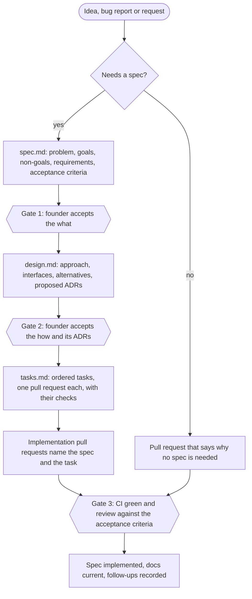

# Spec-driven development

Changes that matter reach `main` through written intent that a person
approved. You approve *what* and *why* before an agent decides *how*. Every
decision that shapes the system is recorded where the next person or agent
will read it. Agents draft and implement; only the founder accepts.

## Records

| Record | Answers | Lives in | Approved by |
| --- | --- | --- | --- |
| Spec | What we build, why, and how we will know it works | [`specs/NNNN-slug/`](../../specs/README.md) | The founder, in the spec's pull request |
| Decision record (ADR) | One choice that shapes the system, the options and the trade-offs | [`docs/decisions/NNNN-slug.md`](../decisions/README.md) | The founder, in the record's pull request |
| Layer map | Which crate may depend on which | [`docs/architecture/layers.toml`](../architecture/layers.toml) | An ADR for every rule change |
| Agent rules and skills | Traps and procedures for agents | `.rules`, `crates/*/AGENTS.md`, `.agents/skills/` | Review of the pull request that adds them |

The [crate map](../architecture/crate-map.md) and both indexes are generated.
`script/architecture verify` fails in CI when any of them is stale or when a
dependency breaks the layer map.

## When a change needs a spec

Write the spec before the code when the change:

- adds or changes something a user can see or rely on;
- changes a file format, schema, wire contract, public API, MCP tool or design op;
- adds, removes, splits or moves a crate, or changes `layers.toml`;
- spans repositories (editor and backend, editor and fanta-ui, engine and SDK);
- changes release, distribution, billing, security or privacy behavior;
- needs more than one pull request.

A change needs no spec when it restores documented behavior (a bug fix),
refactors inside one layer without changing behavior, or only touches tests,
docs or dependency versions. When unsure, write only the spec's first part:
the problem and the acceptance criteria. That takes minutes and gives you
something to approve.

## When a change needs a decision record

Write an ADR when you choose between options with lasting consequences:
structure, dependencies, technology, formats, contracts, repository layout,
licensing, distribution or process. Adding a seam to `layers.toml` or
reversing an earlier decision always needs one. A spec can produce several
ADRs; an ADR never describes implementation steps.

## The flow



A small spec can pass gates 1 and 2 in one pull request. A large one goes in
two: the spec first, then the design and tasks once the spec is accepted.

## Statuses

| Record | Statuses |
| --- | --- |
| Spec | `draft` → `accepted` → `in-progress` → `implemented`, or `abandoned` |
| ADR | `proposed` → `accepted` or `rejected`; later `deprecated` or `superseded` |

Statuses change in a pull request that the founder approves. An agent never
marks its own proposal accepted. When an ADR is superseded, the old record
gets `status: superseded` and `superseded-by`, and the new one lists it in
`supersedes`; the script checks that both sides agree.

## What agents do

The [`spec-driven-development` skill](../../.agents/skills/spec-driven-development/SKILL.md)
holds the step-by-step. In short:

1. Look for an accepted spec in [`specs/README.md`](../../specs/README.md)
   and for decisions that cover the area in [`docs/decisions/README.md`](../decisions/README.md).
2. If the change crosses the spec threshold and nothing covers it, write or
   update the spec as `draft`, open the pull request and stop for review.
3. Implement one task per pull request. If the plan has to change, change
   `design.md` or `tasks.md` in the same pull request and say so.
4. A decision made along the way becomes a `proposed` ADR in the same pull
   request, called out in its description.
5. Close the loop: tick the task, update the docs the change made wrong, and
   ask the founder to move the spec to `implemented` with the last task.

## Pull requests

The pull request template asks for a **Spec and decisions** section:

```text
Spec: specs/0002-fanta-engine-repository (task 3)
Decisions: adds 0024 (proposed); follows 0023
```

or, below the threshold:

```text
None: bug fix that restores the documented autosave retry
```

## What keeps production under control

1. **Intent.** Accepted specs and ADRs say what may be built.
2. **Structure.** `script/architecture check` refuses dependencies that break
   the layer map, so the engine cannot quietly start depending on the editor.
3. **Behavior.** Crate tests, the `script/verify-fanta-release` stages and
   the named regressions in `check.yml` (ADR 0013).
4. **Merge.** Branch rules on `main` that require a pull request and green
   checks. Today `main` only blocks deletion and force pushes; spec 0003
   proposes the rules.
5. **Release.** Signed builds come only from CI (ADRs 0012 and 0017).

A weekly pass keeps the loop honest: read both indexes, and resolve anything
`proposed` or `draft` for more than a week. Accept it, reject it or delete it.

## Keeping records true

- Never rewrite the decision in an accepted ADR. Supersede it with a new one.
  Typo, link and status fixes are fine; add a dated note for anything else.
- Keep an accepted `spec.md` stable. Record later changes under
  "Changes after acceptance" with the date and the reason.
- ADRs 0002–0022 were reconstructed on 2026-10-27 from commits, pull
  requests, docs and session notes. Each cites its evidence. Where nobody
  wrote down the reasoning at the time, the record says so.

## Commands

```bash
script/architecture new spec "Title"
```

```bash
script/architecture new adr "Title"
```

```bash
script/architecture verify
```

`map` and `index` rewrite the generated files after a change; add `--check`
to see whether they are current without touching them.
